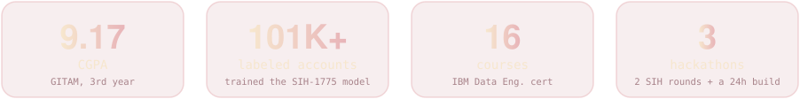
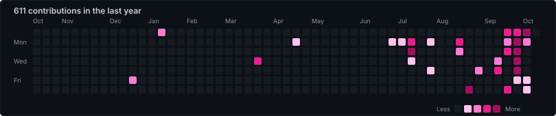

  

  
  
  
  

## 🔮 About

I'm a third-year CSE student at **GITAM University in Visakhapatnam** (CGPA 9.17), interested in data engineering and backend work. I would rather build a pipeline that copes with bad input than tune a model for another half a point of accuracy.

- 💼 **Software engineering intern @ Motherson Technology Services** (AIML team). I built the chat-history storage for LegalLens, an AI legal-research platform: a FastAPI module with 9 endpoints, SQLite for metadata and Azure Blob Storage for message payloads.

I'm open to data engineering and backend internships.

  

## 🎓 Education

**B.Tech in Computer Science and Engineering** · GITAM University, Visakhapatnam · 2024 to 2028

- 📚 **Coursework:** DBMS · Algorithms · Data Structures · Operating Systems · Data Warehousing and Mining · Computer Networks · Machine Learning · Probability and Statistics
- 📜 **IBM Data Engineering Professional Certificate** on Coursera: 16 courses across Airflow, Kafka, Spark, Hadoop, NoSQL and BI dashboards ([see it on LinkedIn](https://www.linkedin.com/in/pushpamrajsatyarthi/details/certifications/))

## 🧭 How I like to build

- 🔧 Started with **C and C++**, and I still care about memory and efficiency
- 🧱 Drawn to **backends and data systems**: APIs, ETL, schemas and anything that has to keep working when the input is messy
- 🚀 I like owning a thing **end to end**, from the database to the UI, and shipping it live
- 🔍 Fond of **explainable** results: SHAP reasons, audit logs and tests that say what broke

## ⚡ Projects

<table>
  <thead>
    <tr>
      <th align="center" width="280">Project</th>
      <th align="center">What it does</th>
      <th align="center" width="200">Stack</th>
    </tr>
  </thead>
  <tbody>
    <tr>
      <td align="center" valign="middle" width="280"></td>
      <td align="justify" valign="middle">Two XGBoost classifiers trained on about 101,000 labeled accounts: 90.04% accuracy for X and 96.87% for Meta platforms. Removing a noisy tweet-level dataset lifted X from 67% to 90.04%. SHAP risk factors in plain English, a NetworkX graph for coordinated accounts, PDF case-file export, and Playwright scraping that never stores credentials. Built for SIH-1775 (ITBP / Ministry of Home Affairs).</td>
      <td align="center" valign="middle">Python, XGBoost, SHAP, FastAPI, React, NetworkX</td>
    </tr>
    <tr>
      <td align="center" valign="middle" width="280"></td>
      <td align="justify" valign="middle">Scrapes market capitalization data for the largest banks, converts currencies with vectorized operations, and loads the result into SQLite and CSV, with timestamped logging at each stage.</td>
      <td align="center" valign="middle">Python, Pandas, NumPy, BeautifulSoup, SQLite</td>
    </tr>
    <tr>
      <td align="center" valign="middle" width="280"> </td>
      <td align="justify" valign="middle">Clinic app where students book doctors and doctors record diagnoses and prescriptions. Built at a 24-hour university hackathon; the repo has 29 integration checks.</td>
      <td align="center" valign="middle">Node.js, Express, PostgreSQL, JWT, bcrypt</td>
    </tr>
    <tr>
      <td align="center" valign="middle" width="280"> </td>
      <td align="justify" valign="middle">Road-trip planner with maps, nearby stops and a chat assistant. Started for Smart India Hackathon 2025, still in development.</td>
      <td align="center" valign="middle">TypeScript, React, Express, MongoDB, Gemini</td>
    </tr>
    <tr>
      <td align="center" valign="middle" width="280"> </td>
      <td align="justify" valign="middle">MERN app that connects kitchens with surplus food to NGOs.</td>
      <td align="center" valign="middle">MERN</td>
    </tr>
    <tr>
      <td align="center" valign="middle" width="280"> </td>
      <td align="justify" valign="middle">WebGL scene built from Spotify listening history.</td>
      <td align="center" valign="middle">WebGL</td>
    </tr>
    <tr>
      <td align="center" valign="middle" width="280"></td>
      <td align="justify" valign="middle">Secure data erasure and file recovery tool with a hash-chained audit log.</td>
      <td align="center" valign="middle">&nbsp;</td>
    </tr>
  </tbody>
</table>

<b>🧪 Smaller builds</b>

- ⚙️ **Autocomplete engine** in C, built on a Trie and a min-heap
- 🛣️ **TollFlow**, an Airflow ETL pipeline
- 🏛️ **Star-schema warehouse** in PostgreSQL
- 🧬 **Entity resolution** with ML, for ML Challenge 2026
- 🛰️ **LiDAR elevation mapping** (C++ and Python), a Smart India Hackathon project

Also, practice repositories I set up for first-time contributors at GITAM:   

## 🤝 Leadership and Community

- 🏛️ **President, IEEE Computer Society GITAM Vizag** · Sept 2026 to now
- 🐙 **Domain Lead, Open Source and Developer Experience (OS/DE), GitHub Community GITAM** · Aug 2026 to now. I run Git and GitHub workshops and walk students through their first pull request
- ✈️ **Aircraft Domain Lead, AeroGitam Club** · Feb to Nov 2025

## 🛠️ Tech Stack

**Languages** 
      

**Data** 
       

**Databases** 
   

**Backend & Web** 
     

**Machine Learning** 
     

**Tools** 
      

**Also:** Make · GDB · Valgrind

## 🏆 Hackathons

- **Smart India Hackathon 2026:** internal-round qualifier, fake account detection engine (SIH-1775)
- **Smart India Hackathon 2025:** internal-round qualifier, TripSync
- **24-hour university hackathon:** KAPS MedTech backend

## 🎧 Beyond code

- 🧩 **Speed-cubing**
- 🎶 **Music**, a *lot* of it. I even built a 3D map out of Spotify listening history ([Astra](https://github.com/pushpam2404/astra-3d-music-universe))
- 📖 **Books**, mostly fiction
- 🍥 **Anime**, a *lot* of that too

## 📊 Activity

  

  

  
  

The contribution graph and the snake are regenerated daily by the workflows in `.github/workflows`.

<i>I like building things.</i>

  📫 <a href="mailto:prsatyarthi2404@gmail.com">prsatyarthi2404@gmail.com</a> ·
  <a href="https://linkedin.com/in/pushpamrajsatyarthi">LinkedIn</a> ·
  <a href="https://pushpam2404-profile.vercel.app">Portfolio</a>

